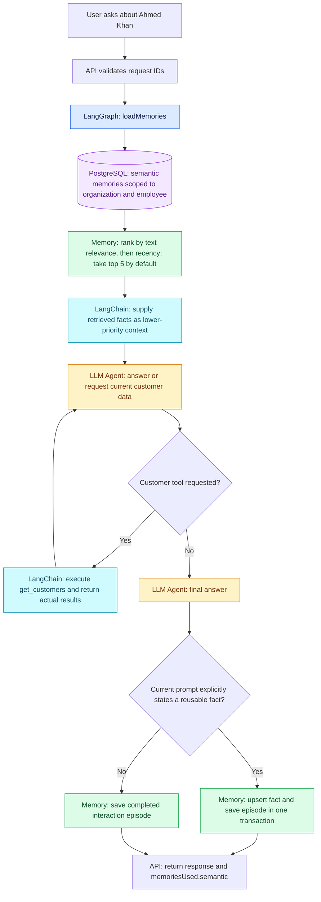
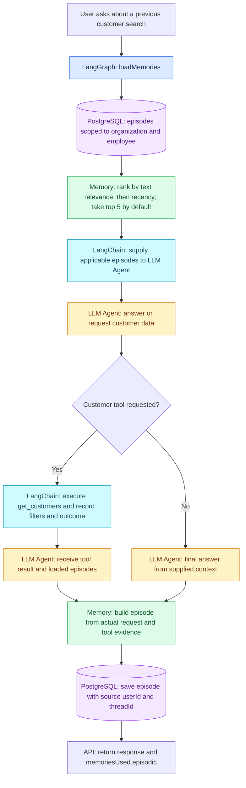
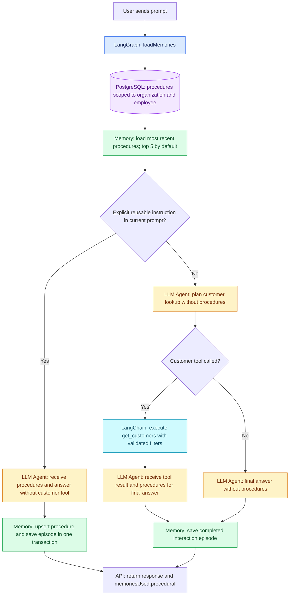

# Employee memory search flowcharts

Every `POST /api/chat` turn loads all three memory types before the agent runs. Every PostgreSQL memory query is scoped by both `organizationId` and `employeeId`. The stored `userId` and `threadId` identify a memory's source but do not restrict employee-wide recall. Each category returns at most `MEMORY_LIMIT` records (default: five).

The diagrams follow the current implementation. `memoriesUsed` in the chat response contains records actually supplied to the model, which can differ from records loaded from PostgreSQL.

## Semantic memory: reusable facts

Example: `Remember that Ahmed Khan works at SalesTeq in the IT industry.` saves a semantic fact after that response completes. A later thread can retrieve it when asking about Ahmed Khan. A question about the fact does not create another semantic fact.

## Episodic memory: previous interactions

For a normal customer request, episodes created by standalone procedure instructions are excluded from initial customer lookup planning. After a tool call, the loaded episodes can be supplied for the final answer. An episode is saved only after a final response, and its outcome distinguishes real results, no matches, and tool failure. The turn ID prevents a retried save from duplicating that episode.

## Procedural memory: reusable instructions and preferences

Example: `Always display customer results in a table.` is saved as a procedure after a completed response. In a later customer lookup, the procedure is supplied when the agent formats the tool result. Presentation preferences are not added to `get_customers` filters. If a normal turn ends without a tool call, loaded procedures are not supplied to that turn's final model response.

For requests that exercise these paths, see [Memory cURL examples](memory-curl-examples.md).
