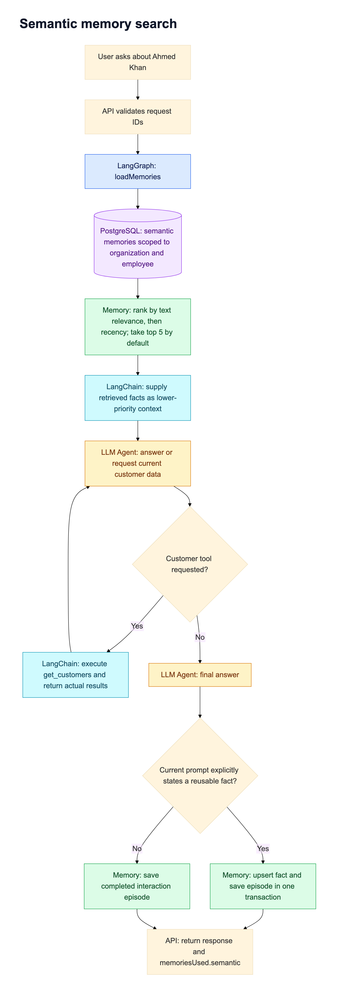
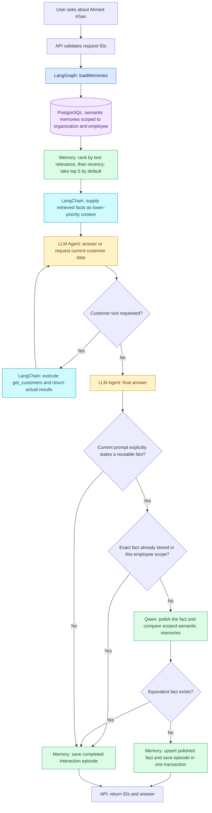
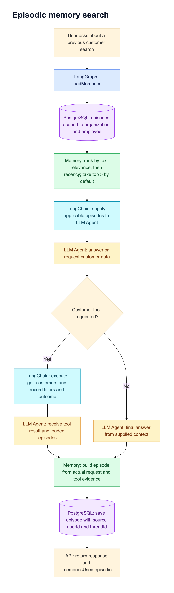
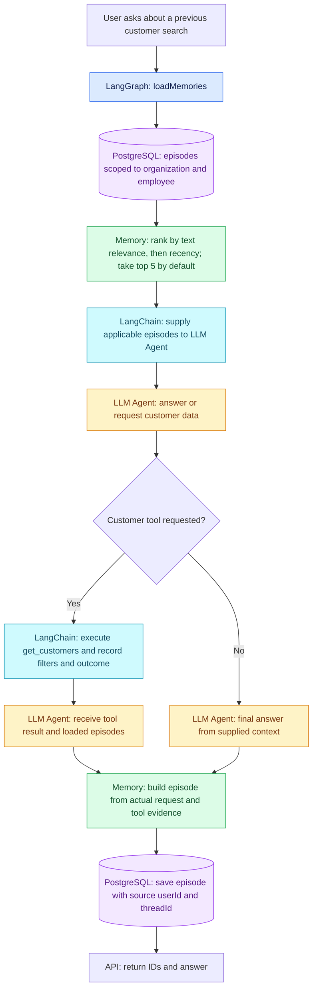
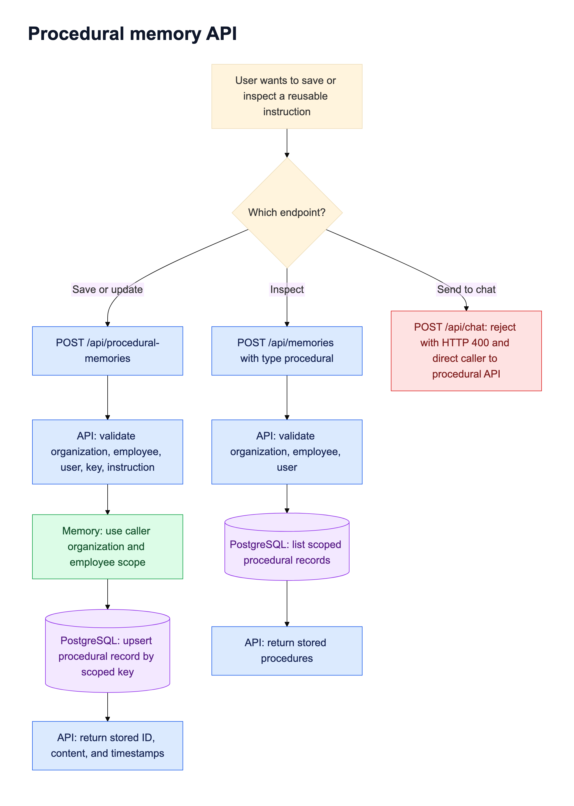

# Employee memory search flowcharts

Every `POST /api/chat` turn loads semantic, episodic, and procedural memory before the agent runs. Procedures are written through `POST /api/procedural-memories` and inspected with `POST /api/memories`. Chat uses saved procedures only when presenting its final answer; it does not write them. Every PostgreSQL memory query is scoped by both `organizationId` and `employeeId`. The stored `userId` and `threadId` identify a memory's source but do not restrict employee-wide recall. Chat loads at most `MEMORY_LIMIT` records per category (default: five).

The diagrams show the internal memory flow. The chat API returns identifiers and the generated answer; it does not expose tool calls, retrieved memory context, memory-write status, or execution trace.

## Semantic memory: reusable facts

Example: `Remember that Ahmed Khan works at SalesTeq in the IT industry.` saves a semantic fact after that response completes. A later thread can retrieve it when asking about Ahmed Khan. A question about the fact does not create another semantic fact.

## Episodic memory: previous interactions

Legacy episodes created by standalone procedure instructions in earlier versions are excluded from chat context. An episode is saved only after a final response, and its outcome distinguishes real results, no matches, and tool failure. The turn ID prevents a retried save from duplicating that episode.

## Procedural memory: API writes, chat presentation

```mermaid
flowchart TD
    userPrompt["User saves a reusable display preference"] --> writeApi["POST /api/procedural-memories"]
    writeApi --> writeValidate["API: validate organization, employee, user, key, instruction"]
    writeValidate --> writeScope["Memory: use caller organization and employee scope"]
    writeScope --> exact{"Exact instruction already stored in this employee scope?"}
    exact -- Yes --> writeResponse
    exact -- No --> candidates[("PostgreSQL: retrieve scoped procedures for comparison")]
    candidates --> refine["Qwen: polish wording and compare meanings"]
    refine --> duplicate{"Equivalent instruction exists?"}
    duplicate -- Yes --> writeResponse["API: return already_exists and existing record"]
    duplicate -- No --> writeDb[("PostgreSQL: insert or update polished procedure by scoped key")]
    writeDb --> saveResponse["API: return created or updated and stored record"]
    saveResponse --> nextPrompt["Later user sends Fetch Customers to POST /api/chat"]
    writeResponse --> nextPrompt["Later user sends Fetch Customers to POST /api/chat"]
    nextPrompt --> loadNode["LangGraph: loadMemories"]
    loadNode --> readDb[("PostgreSQL: load recent procedures for organization and employee")]
    readDb --> toolDecision["LLM Agent: choose get_customers filters without procedures"]
    toolDecision --> customerTool["LangChain: run get_customers with actual filters"]
    customerTool --> draft["LLM Agent: draft answer from real customer rows"]
    draft --> presentation["Same Qwen model: apply saved procedure to final display"]
    readDb --> presentation
    presentation --> chatResponse["API: return IDs and answer"]
    writeResponse --> readApi["Optional: POST /api/memories with type procedural"]
    saveResponse --> readApi
    readApi --> readValidate["API: validate organization, employee, user"]
    readValidate --> inspectDb[("PostgreSQL: list scoped procedural records")]
    inspectDb --> readResponse["API: return stored procedures"]
    badWrite["Reusable instruction sent directly to chat"] --> chatReject["API: reject write with HTTP 400"]
    classDef apiNode fill:#dbeafe,stroke:#2563eb,color:#172554
    classDef graphNode fill:#dbeafe,stroke:#2563eb,color:#172554
    classDef memoryNode fill:#dcfce7,stroke:#16a34a,color:#14532d
    classDef dataNode fill:#f3e8ff,stroke:#9333ea,color:#581c87
    classDef agentNode fill:#fef3c7,stroke:#d97706,color:#78350f
    classDef chainNode fill:#cffafe,stroke:#0891b2,color:#164e63
    classDef rejectNode fill:#fee2e2,stroke:#dc2626,color:#7f1d1d
    class writeApi,writeValidate,writeResponse,saveResponse,nextPrompt,chatResponse,readApi,readValidate,readResponse apiNode
    class writeScope,refine memoryNode
    class loadNode graphNode
    class candidates,writeDb,readDb,inspectDb dataNode
    class toolDecision,draft,presentation agentNode
    class customerTool chainNode
    class chatReject rejectNode
```

Example: save `{"key":"ins-1","instruction":"Always add prefix Custo- with the customer Name while fetching Customers"}` through `POST /api/procedural-memories`. A later `Fetch Customers` chat turn retrieves actual rows first, then applies the prefix to its returned answer. The chat API omits the tool-call details. Sending the reusable instruction to chat directly is rejected.

For requests that exercise these paths, see [Memory cURL examples](memory-curl-examples.md).
